  

  
  

## What we forge

**Tenebris Forge** is an independent studio from Brazil. We build:

- **Horror games**: online experiences made to unsettle, with atmosphere first.
- **Web apps**: products for players and communities, fast and dependable.
- **Tools**: the small pieces that help games and players, built with care.

## How we work

Small team, high standard: every change starts as an issue, goes through review and tests,
and ships continuously.

  

Founded by <a href="https://github.com/brunolemosdl">Bruno Lemos de Lima</a>.

